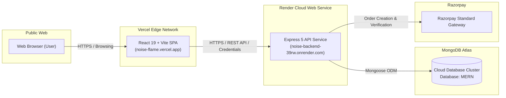

# ⚡ NOISE. // Raw Streetwear E-Commerce Platform

> **"Raw Streetwear. Unfiltered Attitude."**  
> A high-performance, full-stack MERN e-commerce application engineered with bold Neo-Brutalist design aesthetics, secure cross-domain authentication, Razorpay payments, and cloud-native multi-service deployment.

[](https://noise-flame.vercel.app)
[](https://noise-backend-39rw.onrender.com/health)
[](https://www.mongodb.com/cloud/atlas)
[](https://react.dev)
[](https://nodejs.org)
[](https://tailwindcss.com)

---

## 📌 Project Overview & Submission Details

* **Student / Author**: Hardik Hansraj
* **Course / Context**: Full-Stack MERN Lab Project Submission (Scaler School of Technology)
* **GitHub Repository**: [https://github.com/HardikH25/NOISE](https://github.com/HardikH25/NOISE)
* **Production Frontend (Vercel)**: [https://noise-flame.vercel.app](https://noise-flame.vercel.app)
* **Production API Backend (Render)**: [https://noise-backend-39rw.onrender.com](https://noise-backend-39rw.onrender.com)
* **API Health Check Endpoint**: [https://noise-backend-39rw.onrender.com/health](https://noise-backend-39rw.onrender.com/health)

---

## 🚀 Key Highlights & Architectural Features

### 🎨 Neo-Brutalist User Interface & Client Experience
* **Neo-Brutalist Design System**: High-contrast 4px–8px solid black borders, hard offset drop shadows (`neo-shadow-sm`, `neo-shadow-md`, `neo-shadow-lg`), vivid color blocks (`#FFD93D`, `#FF6B6B`, `#4ADE80`, `#C4B5FD`), angled sticker badges, and marquee broadcast banners.
* **Dual-Layer Experience**:
  * **Guest Landing Page (`/`)**: Brand manifesto, lookbook hero with interactive preview, drop countdown tickers, curated categories, trust badges, and newsletter subscription.
  * **Customer Portal (`/home`)**: Authenticated customer command center displaying personalized greeting, membership status, and instant drops access.
* **Complete E-Commerce Flow**:
  * **Product Catalog (`/products`)**: Real-time category filtering (Hoodies, Sneakers, Graphic Tees, Cargos), inventory counts, and responsive cards.
  * **Product Details (`/products/:id`)**: Live stock status indicator, quantity selectors, dynamic pricing, and stock depletion guards.
  * **Cart & Wishlist (`/cart`, `/wishlist`)**: Interactive stateful cart with instant line-item subtotals, quantity adjustments, item removal, and empty state CTA.
  * **Checkout & Razorpay Integration (`/checkout`)**: Multi-step checkout with delivery address capture, live order summary, and Razorpay standard checkout integration.
  * **Order Success & History (`/order-success/:id`, `/orders`)**: Order confirmation receipts with itemized order breakdown and persistent order tracking.
* **Brand Integrity & Policy Pages**:
  * Dedicated pages for **About Us**, **FAQ**, **Returns & Exchanges** (*"All Sales Are Final — Limited Drops"* policy), **Privacy Policy**, and **Terms of Service**.
  * Zero placeholder emails; 100% consistent NOISE brand identity across all views.
* **SPA Routing Stability**: Built-in `vercel.json` routing rules ensuring full single-page application route rewrites with zero 404 errors upon direct link refresh.

### 🛡️ Production-Grade Backend Architecture
* **Express 5 REST API**: Clean MVC pattern separating controllers, models, routes, and custom middlewares.
* **Secure Authentication**:
  * Passwords hashed using `bcrypt` (10 salt rounds).
  * JWT session tokens issued inside `HttpOnly`, `Secure`, `SameSite: None` cookies to guarantee secure cross-domain authentication between Vercel and Render.
* **Dynamic CORS & Domain Normalization**:
  * Automatic normalization of `CLIENT_URL` (stripping accidental trailing slashes).
  * Whitelist support for local dev (`localhost:5173`), exact production `CLIENT_URL`, and wildcard regex matching for all `*.vercel.app` preview environments.
* **MongoDB Atlas Integration**: Hosted cloud MongoDB cluster connected via Mongoose with strict schema definitions, automated timestamps, and cascading references.
* **Payment Verification**: Server-side HMAC SHA-256 signature verification for Razorpay payment webhooks to prevent spoofed transactions.
* **DevOps & Monitoring**: Dedicated `/health` endpoint returning system uptime, service name, and ISO timestamp for cloud liveness probes.

---

## 🛠️ Technology Stack

| Layer | Technologies Used |
| :--- | :--- |
| **Frontend** | React 19, Vite, TailwindCSS (Neo-Brutalism), React Router DOM 7, Axios, Lucide / Heroicons |
| **Backend** | Node.js, Express.js (ES Modules), Mongoose, JSON Web Tokens (JWT), Bcrypt, Cookie-Parser, CORS |
| **Database** | MongoDB Atlas (Cloud Cluster M0) |
| **Payment Gateway** | Razorpay Standard Checkout SDK |
| **Cloud Hosting** | **Frontend**: Vercel (Edge Network) <br> **Backend**: Render (Web Service) <br> **Database**: MongoDB Atlas |

---

## 📂 Project Directory Structure

```text
Ecom_MERN/
├── README.md                          # Master Project Documentation
├── client/
│   └── vite-project/
│       ├── .env.example               # Frontend environment template
│       ├── vercel.json                # Vercel SPA rewrite configuration
│       ├── package.json
│       ├── vite.config.js
│       ├── public/                    # Production static assets (lookbooks, brand images)
│       │   ├── img.jpg                # Lookbook cover 1 ("Take What's Yours")
│       │   ├── img5.jpg               # Lookbook cover 2 (Grass Meadow Hero)
│       │   ├── img6.jpg               # BMX Streetwear Collage
│       │   ├── collection_hoodie.jpg
│       │   ├── collection_sneakers.jpg
│       │   ├── collection_gtees.jpg
│       │   └── collection_cargos.jpg
│       └── src/
│           ├── axiosCalls/
│           │   └── axios.js           # Dynamic Axios instance with VITE_API_BASE_URL
│           ├── components/
│           │   ├── Navbar.jsx         # Persistent authenticated header
│           │   ├── Footer.jsx         # Neo-Brutalist footer with quick links
│           │   ├── ProductCard.jsx    # Interactive product card with badges
│           │   ├── ProtectedRoute.jsx # Route guard for logged-in users
│           │   └── PublicRoute.jsx    # Route guard for guests
│           ├── context/
│           │   ├── AuthContext.jsx    # Global authentication & customer state
│           │   └── CartContext.jsx    # Global cart state & badge counts
│           └── Pages/
│               ├── Landing.jsx        # Public guest storefront & hero
│               ├── Home.jsx           # Authenticated customer dashboard
│               ├── Products.jsx       # Catalog with category filtering
│               ├── ProductDetails.jsx # Detailed single-product view
│               ├── Cart.jsx           # Shopping bag & checkout gate
│               ├── Checkout.jsx       # Address form & Razorpay trigger
│               ├── OrderSuccess.jsx   # Order receipt confirmation
│               ├── Orders.jsx         # Past customer orders list
│               ├── Wishlist.jsx       # Saved customer favorites
│               ├── Login.jsx          # Customer login
│               ├── Signup.jsx         # Customer registration
│               ├── About.jsx          # Brand story & manufacturing ethos
│               ├── FAQ.jsx            # Frequently Asked Questions
│               ├── Returns.jsx        # 'All Sales Final' policy
│               ├── Privacy.jsx        # Data privacy disclosure
│               └── Terms.jsx          # Terms of Service & drop limits
└── server/
    ├── .env.example                   # Backend environment template
    ├── package.json                   # Backend dependencies & start script
    ├── index.js                       # Express app bootstrap, CORS, & DB connection
    ├── controllers/
    │   ├── customer.controller.js     # Signup, login, logout, profile
    │   ├── product.controller.js      # Product query, single product lookup
    │   ├── cart.controller.js         # Add, update quantity, remove from cart
    │   ├── wishlist.controller.js     # Add, remove, list wishlist items
    │   ├── order.controller.js        # Create Razorpay order, verify signature
    │   └── newsletter.controller.js   # Newsletter subscription with deduplication
    ├── models/
    │   ├── customer.model.js          # Customer schema (name, email, password, phone)
    │   ├── product.model.js           # Product schema (name, price, stock, category, image)
    │   ├── order.model.js             # Order schema (items, amount, paymentId, status)
    │   └── subscriber.model.js        # Newsletter subscriber schema
    ├── routes/
    │   ├── customer.routes.js
    │   ├── product.routes.js
    │   ├── cart.routes.js
    │   ├── wishlist.routes.js
    │   ├── order.routes.js
    │   └── newsletter.routes.js
    └── middlewares/
        └── authMiddleware.js          # JWT verification & customer context injection
```

---

## 📡 REST API Reference

### Health & System
| Method | Endpoint | Description | Auth Required |
| :--- | :--- | :--- | :--- |
| `GET` | `/health` | Cloud provider liveness probe | No |
| `GET` | `/` | API welcome status | No |

### Authentication (`/customers`)
| Method | Endpoint | Payload | Response | Auth |
| :--- | :--- | :--- | :--- | :--- |
| `POST` | `/customers/register` | `{ fullname, email, password, phone }` | Sets HTTP-only JWT cookie, returns customer object | No |
| `POST` | `/customers/login` | `{ email, password }` | Sets HTTP-only JWT cookie | No |
| `POST` | `/customers/logout` | None | Clears JWT cookie | Yes |
| `GET` | `/customers/profile` | None | Returns logged-in customer profile | Yes |

### Products (`/products`)
| Method | Endpoint | Query Params | Description |
| :--- | :--- | :--- | :--- |
| `GET` | `/products` | `?category=Hoodies` *(optional)* | Retrieve catalog filtered by category |
| `GET` | `/products/:id` | None | Retrieve single product with stock details |

### Cart & Wishlist (`/cart`, `/wishlist`)
| Method | Endpoint | Payload | Description | Auth |
| :--- | :--- | :--- | :--- | :--- |
| `GET` | `/cart` | None | Fetch customer cart items | Yes |
| `POST` | `/cart/add` | `{ productId, quantity }` | Add item or increment quantity | Yes |
| `DELETE`| `/cart/remove/:productId` | None | Remove item from cart | Yes |
| `GET` | `/wishlist` | None | Fetch customer wishlist | Yes |
| `POST` | `/wishlist/toggle` | `{ productId }` | Add/remove product from wishlist | Yes |

### Orders & Payments (`/orders`)
| Method | Endpoint | Payload | Description | Auth |
| :--- | :--- | :--- | :--- | :--- |
| `POST` | `/orders/create-razorpay-order` | `{ amount }` | Creates Razorpay order instance | Yes |
| `POST` | `/orders/verify-payment` | `{ razorpay_order_id, razorpay_payment_id, razorpay_signature, items, address }` | Verifies cryptographic signature & persists order in MongoDB | Yes |
| `GET` | `/orders/my-orders` | None | Fetch logged-in customer order history | Yes |

### Newsletter (`/newsletter`)
| Method | Endpoint | Payload | Description | Auth |
| :--- | :--- | :--- | :--- | :--- |
| `POST` | `/newsletter/subscribe` | `{ email }` | Adds email to subscriber list (deduplicated) | No |

---

## 💻 Local Development Setup Guide

### 1. Prerequisites
* **Node.js**: v18.x or v20.x installed ([Download Node.js](https://nodejs.org))
* **Git**: Installed and configured
* **MongoDB**: A free MongoDB Atlas cluster connection string or a local MongoDB instance

---

### 2. Clone the Repository
```bash
git clone https://github.com/HardikH25/NOISE.git
cd NOISE
```

---

### 3. Backend Setup
1. Navigate to the `server/` directory:
   ```bash
   cd server
   npm install
   ```

2. Create your `.env` configuration file from the template:
   ```bash
   cp .env.example .env
   ```

3. Open `.env` and fill in your values:
   ```env
   PORT=8070
   NODE_ENV=development
   dbURL=your_mongodb_connection_string
   JWT_SECRET=your_jwt_secret_key
   CLIENT_URL=http://localhost:5173
   RAZORPAY_KEY_ID=your_razorpay_key_id
   RAZORPAY_KEY_SECRET=your_razorpay_key_secret
   ```

4. Start the backend development server:
   ```bash
   npm run dev
   # Server will run at http://localhost:8070
   ```

---

### 4. Frontend Setup
1. Open a new terminal and navigate to the frontend directory:
   ```bash
   cd client/vite-project
   npm install
   ```

2. Create your `.env` configuration file from the template:
   ```bash
   cp .env.example .env
   ```

3. Open `.env` and define the backend API URL:
   ```env
   VITE_API_BASE_URL=http://localhost:8070
   ```

4. Start the Vite development server:
   ```bash
   npm run dev
   # App will run at http://localhost:5173
   ```

5. Open [http://localhost:5173](http://localhost:5173) in your browser.

---

## ☁️ Cloud Deployment Architecture

The application is deployed across independent cloud providers configured for production resiliency:



### Production Environment Settings

#### Frontend (Vercel)
* **Root Directory**: `client/vite-project`
* **Framework Preset**: `Vite`
* **Build Command**: `vite build`
* **Output Directory**: `dist`
* **Environment Variables**:
  * `VITE_API_BASE_URL` = `https://noise-backend-39rw.onrender.com`

#### Backend (Render)
* **Root Directory**: `server`
* **Build Command**: `npm install`
* **Start Command**: `npm start` (runs `node index.js`)
* **Environment Variables**:
  * `NODE_ENV` = `production`
  * `CLIENT_URL` = `https://noise-flame.vercel.app`
  * `dbURL` = `mongodb+srv://...`
  * `JWT_SECRET` = `...`
  * `RAZORPAY_KEY_ID` = `...`
  * `RAZORPAY_KEY_SECRET` = `...`

---

## 🔒 Security Best Practices Implemented

* **Zero Secret Exposure**: `.gitignore` strictly protects `.env`, `.env.local`, and sensitive credential files from being tracked in git history.
* **HttpOnly Session Cookies**: Session tokens cannot be accessed by client-side JavaScript, guarding against XSS token extraction attacks.
* **SameSite & Secure Flags**: Cookies enforce `SameSite: None` and `Secure: true` in production, allowing safe cross-origin transmission between distinct domains (`vercel.app` and `onrender.com`).
* **Cryptographic Password Hashing**: Passwords are salted and hashed with `bcrypt` prior to database writes.
* **Payment Integrity**: Razorpay order payments are verified server-side using SHA-256 HMAC digest validation before orders are persisted as successful.

---

## 📜 License

This project was built for academic evaluation under the Scaler School of Technology (SST) curriculum. All streetwear graphics and brand themes belong to the NOISE concept project.
